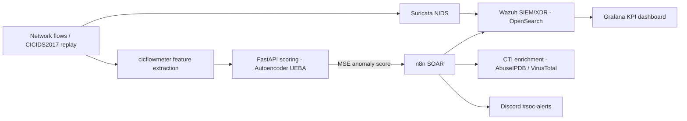

# AI-Enhanced Open-Source Mini-SOC

A lightweight Security Operations Center that pairs a classic open-source detection stack with a custom behavioral-anomaly model (UEBA), and automates the full response pipeline — from a raw network flow to an enriched, qualified alert in **under 9 seconds**, on a single 16 GB laptop.

Built during an initiation engineering internship (Networks & Telecommunications — GRST, ENSA Kénitra), hosted by YLUNOR in Casablanca, Morocco.

## Architecture



## Tech stack

| Layer | Tool |
|---|---|
| Host | Ubuntu LTS, Docker Compose |
| Network detection | Suricata (NIDS) |
| SIEM / XDR | Wazuh (single-node) + OpenSearch |
| Feature extraction | cicflowmeter (Python) |
| AI module | Dense autoencoder (15 features, 1,139 params), served via FastAPI |
| SOAR | n8n |
| Threat intelligence | AbuseIPDB, VirusTotal |
| Visualization | Grafana |
| Alerting | Discord webhook |

## Results (CICIDS2017, unsupervised autoencoder)

| Metric | Value | Target |
|---|---|---|
| Recall | 85.01% | >= 85% |
| Precision | 93.73% | - |
| F1-score | 89.15% | - |
| FPR | 13.95% | <= 15% |

Validated over 30 bootstrap resamplings (std dev < 0.001). Decision threshold (reconstruction MSE) calibrated at 0.2512. End-to-end PoC: a replayed Nmap stealth scan scored 4.03 and drove the full SOAR pipeline (CTI enrichment → Discord → OpenSearch → Grafana) in under 9 seconds.

## How it works

The autoencoder is trained **only on benign traffic**: it learns to reconstruct normal flows and flags anything it reconstructs poorly (high MSE) as an anomaly — unsupervised detection, with no attack labels used at training time. A strict anti-data-leakage preprocessing pipeline (IQR winsorization, log1p with persisted shifts, standardization) is fitted on the benign training split only and re-applied identically at inference.

## Repository structure

```
ia-module/         AI module: preprocessing, training, FastAPI scoring, notebooks
  src/             preprocessing.py, train_models.py, api_scoring.py, ...
  models/          trained autoencoder + scaler artifacts
  notebooks/       EDA and model evaluation
soar/              n8n docker-compose, connector, SOAR documentation
connector_live.py  flow -> scoring API -> n8n bridge
wazuh-docker/      Wazuh single-node deployment (vendored upstream)
report/            figures and proof-of-concept evidence
```

## Quick start (high level)

1. `cd wazuh-docker/single-node && docker compose up -d` — Wazuh + OpenSearch
2. `cd soar && docker compose up -d` — n8n
3. From `ia-module/` (venv with TensorFlow): `uvicorn src.api_scoring:app --host 0.0.0.0 --port 8000`
4. `python connector_live.py` — scores a flow and fires the pipeline

> Secrets (API keys, Discord webhook, passwords) are **not** committed. Set your own in the n8n credentials and in the compose environment files before running.

## Limitations (acknowledged)

- Near-zero safety margin on Recall (85.01% vs the 85% target).
- Heterogeneous detection across attack types: volumetric attacks well detected, subtle ones less so.
- Model trained on 2017 data, so it is exposed to domain shift on modern traffic; production use would require periodic retraining.

## Credits

Internship at **YLUNOR** (Casablanca). Professional supervisor: Mohamed Lasfar. Academic supervisor: Pr. Chaïmaâ Kissi, ENSA Kénitra.

**Author:** Anas El Kartouti
